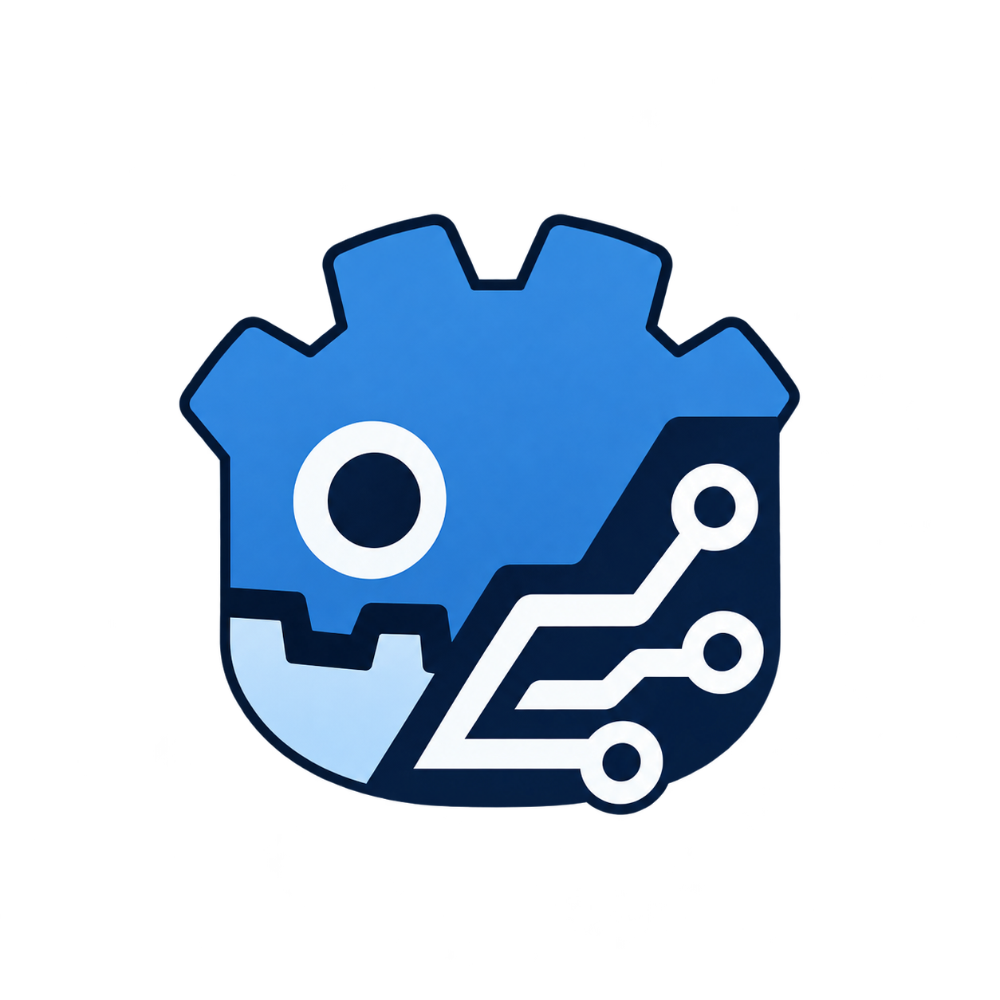
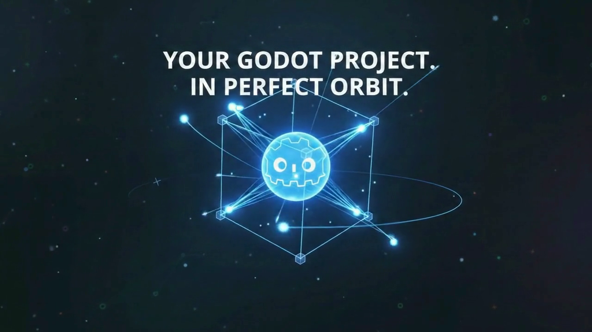

<div align="center">



# 🚀 VGSkillFrame — Videogame Skill Frame
### Godot 4 & Blender 3D AI Skills, MCP Servers & Package Manager CLI

**The Interactive Web GUI, TUI, Model Context Protocol (MCP) Bridge & Curated AI Coding Skills Ecosystem for Godot Engine 4.x and Blender 3D Game Developers**

[](https://orbit-kit-nine.vercel.app)
[](https://www.npmjs.com/package/@francisiv/vgskillframe)
[](https://godotengine.org)
[](https://www.blender.org)
[](https://modelcontextprotocol.io)
[](LICENSE)

**VGSkillFrame (`@francisiv/vgskillframe` / `vgskillframe` / `orbitkit` / `devdock`)** keeps all your local **Godot 4** and **Blender 3D** game projects continuously synchronized with anti-hallucination **GDScript 4 AI Skills**, **Model Context Protocol (MCP) servers** (`Context7`, `Godot LSP`, `Scene Inspector`, `GUT Runner`), and verified **Godot Editor Addons** — compatible out of the box with **Claude Code**, **Cursor**, **Windsurf**, **Antigravity**, and **GitHub Copilot**.

[🌐 Live Website & Docs](https://orbit-kit-nine.vercel.app) • [📦 NPM Package](https://www.npmjs.com/package/@francisiv/vgskillframe) • [📚 Architecture Docs](https://github.com/FrancisCuarto/OrbitKit/tree/main/docs) • [🐛 Report Issue](https://github.com/FrancisCuarto/OrbitKit/issues)

</div>

---

<div align="center">

## 🎬 Overview & Workflow Demo

https://github.com/FrancisCuarto/OrbitKit/raw/main/docs/assets/orbitkit-preview.mp4

<p align="center">
  <video src="https://github.com/FrancisCuarto/OrbitKit/raw/main/docs/assets/orbitkit-preview.mp4" controls="controls" muted="muted" playsinline="playsinline" poster="docs/assets/orbitkit-preview-poster.png" width="100%" style="border-radius: 12px; border: 1px solid #30363d; box-shadow: 0 10px 30px rgba(0,0,0,0.5);">
    <a href="https://github.com/FrancisCuarto/OrbitKit/raw/main/docs/assets/orbitkit-preview.mp4">
      
    </a>
  </video>
</p>

</div>

---

## ✨ Why VGSkillFrame (Videogame Skill Frame) for Godot 4 & Blender?

Most AI coding assistants hallucinate legacy **Godot 3.x GDScript** (`KinematicBody2D`, `yield()`, old `TileMap`, invalid `.tscn` UIDs) because their training cutoffs mix Godot 3 and Godot 4 APIs.

**VGSkillFrame** solves this with a single command:
- 🧠 **9 Curated Godot 4 & Blender 3D AI Skills**: Enforces strict GDScript 4.3+ static typing, `CharacterBody2D/3D`, `TileMapLayer`, `FileAccess`, decoupled Finite State Machines, shaders, multiplayer ENet, and Blender-to-Godot `.glb` pipelines in `.agents/skills/` and `.claude/skills/`.
- 🔌 **6 Zero-Config Godot MCP Servers**: Connects your AI agent directly to the Godot 4 GDScript Language Server (`localhost:6005`), Upstash `Context7` live docs, `.tscn`/`.tres` scene hierarchy inspector, and GUT unit test runner via `.mcp.json`.
- 🖥️ **Interactive Web GUI Dashboard & TUI**: Run `vgskillframe` (or `vgskillframe ui`) to open the local Web GUI Dashboard or interactive terminal menu to browse skills, toggle MCP servers, scan projects, and manage updates visually.
- 🔔 **Continuous Background Auto-Updater**: Uses HTTP `ETag` caching and OS-native schedulers (`systemd`, `launchd`, `schtasks`) to detect and apply verified skill updates with atomic rollback.
- 🔒 **Security-First Installer**: Cryptographic SHA-256/512 checksum verification, strict Zip-Slip defense, and path-traversal protection.

---

## ⚡ Quick Start

### 1. Install Globally via NPM
```bash
npm install -g @francisiv/vgskillframe
```

*Or run on-demand with zero installation:*
```bash
npx @francisiv/vgskillframe doctor
```

> **Aliases:** `vgskillframe`, `vgskill`, `orbitkit` and `devdock` binaries are all registered globally. Use whichever you prefer!

### 2. Launch the Interactive Web GUI or TUI
```bash
vgskillframe
# or explicitly open the browser dashboard:
vgskillframe ui
```

### 3. Diagnose Your Godot & AI Environment
```bash
vgskillframe doctor
```

### 4. Scan & Keep All Local Godot Projects Updated
```bash
vgskillframe scan .
vgskillframe update --all
```

---

## 🛠️ CLI Command Matrix

| Command | Description |
|---|---|
| `vgskillframe` | Launches the interactive VGSkillFrame dashboard / minimalist TUI menu. |
| `vgskillframe ui` *(alias `gui`)* | Launches the interactive VGSkillFrame GUI web dashboard in your browser. |
| `vgskillframe doctor` | Diagnoses Godot 4 binary, LSP port 6005, and project context. |
| `vgskillframe scan [dir]` | Recursively scans for Godot projects and inspects installed addons and skills. |
| `vgskillframe init` | Initializes VGSkillFrame in current game project and installs default skills/MCPs. |
| `vgskillframe check [--json] [--force]` | Checks remote catalog for new/outdated AI skills and CLI updates (works offline via cache). |
| `vgskillframe watch` | Foreground watcher that periodically checks and applies safe skill updates. |
| `vgskillframe autoupdate enable\|disable` | Configures OS-native scheduled checks (`systemd`, `launchd`, `schtasks`). |
| `vgskillframe update [--all]` | Upgrades AI skills and addons to latest verified versions across projects. |
| `vgskillframe upgrade [--check]` | Checks NPM & GitHub releases and self-updates the global `@francisiv/vgskillframe` CLI. |
| `vgskillframe uninstall [--project]` | Uninstalls the global VGSkillFrame CLI or cleans injected skills/MCPs from a project. |
| `vgskillframe skill list` | Lists all 9 verified Godot 4 & Blender 3D AI Skills. |
| `vgskillframe skill install <id>` | Installs an AI skill into `.agents/skills/` and `.claude/skills/`. |
| `vgskillframe mcp list` | Lists all 6 supported Model Context Protocol servers. |
| `vgskillframe mcp add <server-id>` | Configures an MCP server directly into `.mcp.json`. |

---

## 🧠 Curated Godot 4 & Blender 3D AI Skills

Pre-configured instruction rulesets (`SKILL.md`) that guide **Antigravity**, **Claude Code**, **Cursor**, and **Windsurf** to generate idiomatic, clean **GDScript 4** and **Blender Python (`bpy`)** code:

| Skill ID | Version | Description |
|---|---|---|
| **`godot4-syntax-guardian`** | `v1.3.0` | Anti-hallucination guard. Enforces `TileMapLayer`, `FileAccess`, `Callable` signals, and prevents Godot 3 syntax. |
| **`gdscript-fsm-master`** | `v1.2.0` | Decoupled Finite State Machine pattern for player controllers and enemy combat AI. |
| **`godot-multiplayer-enet`** | `v1.0.0` | Authoritative multiplayer architecture using `ENetMultiplayerPeer` and `@rpc` decorators. |
| **`godot-shader-vfx`** | `v1.2.0` | 2D & 3D `.gdshader` pipeline, screen distortions, and mobile GPU optimization. |
| **`godot-procedural-generation`** | `v1.1.0` | `FastNoiseLite` algorithms, autotiling, and dynamic `AStar2D`/`AStar3D` pathfinding. |
| **`godot-responsive-ui`** | `v1.1.0` | Responsive UI layouts using `Control` Containers and Anchors (no hardcoded coordinates). |
| **`godot-save-system`** | `v1.0.0` | JSON/binary save pipeline with SHA-256 HMAC integrity signatures. |
| **`ctx7-docs-fetcher`** | `v1.0.0` | Live documentation retrieval protocol via Upstash Context7. |
| **`blender-3d-pipeline`** | `v1.2.0` | Automated Blender 4.x to Godot 4 `.glb`/`.gltf` export pipeline, `-col`/`-navmesh` suffixes, and `bpy` scripts. |

👉 [Read the detailed AI Skills Documentation](docs/skills.md)

---

## 🔌 Godot 4 Model Context Protocol (MCP) Suite

Bridge your AI assistants directly into the Godot editor:

- **`ctx7` (Context7 by Upstash)**: Live documentation MCP for version-locked API docs.
- **`godot-engine-bridge`**: Live editor control: run game, capture console/error logs, hot-reload scripts.
- **`godot-lsp`**: Bridges AI assistants to Godot GDScript LSP (`localhost:6005`) for real-time diagnostics.
- **`godot-docs`**: Zero-latency offline documentation lookup for Godot 4 class references.
- **`godot-scene-inspector`**: Parses `.tscn` and `.tres` node hierarchies safely without breaking UIDs.
- **`godot-gut-runner`**: Runs GUT (Godot Unit Testing) test suites and streams results to your AI agent.

```bash
# Example: Add Context7 and Godot LSP to your project
vgskillframe mcp add ctx7
vgskillframe mcp add godot-lsp
```

👉 [Read the detailed MCP Documentation](docs/mcp.md)

---

## 🔔 Auto-Updates & Notifications

VGSkillFrame continuously detects newly published AI skills and updates to installed skills without blocking your terminal commands:

- **Passive Background Checks**: Uses HTTP `ETag` caching (`~/.local/state/vgskillframe/state.json`) and a detached worker so CLI commands never wait on network requests.
- **On-Demand Check**: Run `vgskillframe check` (or `vgskillframe check --json` for CI/tooling) to inspect new skills, outdated skills, and CLI version status.
- **OS Scheduler Integration**: Run `vgskillframe autoupdate enable --every 6h` to register a native `systemd` user timer (Linux), `LaunchAgent` (macOS), or `schtasks` job (Windows).
- **Safe Atomic Updates & Rollback**: `vgskillframe update --all` verifies SHA-256 checksums, creates backups in `.devdock/backups/`, extracts atomically, and rolls back automatically if verification fails.

---

## 🎮 Godot Engine Editor Plugin

Manage packages, updates, and diagnostics directly from Godot:
1. The plugin is auto-installed by `vgskillframe init` or can be installed via `vgskillframe plugin install`.
2. Located in `res://addons/vgskillframe/` and registered in `project.godot`.
3. A dedicated **VGSkillFrame** dock appears in your Godot Editor right panel with real-time scene hierarchy and skills status.

---

## 🔒 Security Architecture

- **Path Traversal Protection**: Rejects file paths containing `..`, absolute paths (`/etc/`), or escaping prefixes.
- **Zip Slip Defense**: Validates every extracted archive member against the target project directory.
- **Cryptographic Checksums**: Verifies packages with SHA-256 / SHA-512 hashes before writing to disk.
- **Restricted Directories**: Installs strictly to `res://addons/` and `.agents/skills/`.

👉 [Read the Security Policy](docs/security.md)

---

## 🌳 Git Branching & Workflow

```text
feature/<name>  ───►  develop  ───►  stage  ───►  main (Production)
```

- **`main`**: Production branch deployed to Vercel and NPM.
- **`stage`**: Release candidates and pre-production staging.
- **`develop`**: Active development and integration branch.
- **`feature/*`**: Create your branch off `develop` when contributing new features.

---

## 📦 Monorepo Structure

```text
VGSkillFrame/
├── packages/
│   ├── cli/               # @francisiv/vgskillframe (CLI binary: vgskillframe)
│   ├── manifest-schema/   # Zod manifest schema & security verifications
│   └── shared-types/      # Shared TypeScript types & API contracts
├── apps/
│   ├── web/               # Official Documentation & Web portal (Vite + React)
│   └── api/               # Central REST API (Express + Argon2id)
├── godot-plugin/
│   └── addons/vgskillframe/ # Native Godot 4 Editor Addon
└── docs/                  # In-depth architectural & API guides
```

---

## 🌐 Español — Resumen Rápido

**VGSkillFrame (`@francisiv/vgskillframe`)** (Videogame Skill Frame) es el ecosistema de **AI Skills**, servidores **Model Context Protocol (MCP)** y gestor de paquetes para desarrolladores de **Godot Engine 4** y **Blender 3D**. Evita que asistentes de IA (**Claude Code, Cursor, Windsurf, Antigravity**) alucinen sintaxis obsoleta de Godot 3 e integra documentación en tiempo real, panel web local (`vgskillframe ui`) y actualizaciones automáticas seguras.

- **Web oficial y documentación interactiva:** [https://orbit-kit-nine.vercel.app](https://orbit-kit-nine.vercel.app)
- **Instalación global:** `npm install -g @francisiv/vgskillframe`

---

## 🤝 Contributing

Contributions are welcome — new AI Skills, MCP servers, addons, docs and bug fixes!

- 📝 Read the [Contributing Guide](.github/CONTRIBUTING.md)
- 🐛 [Report a bug](https://github.com/FrancisCuarto/OrbitKit/issues/new?template=bug_report.yml)
- ✨ [Request a feature](https://github.com/FrancisCuarto/OrbitKit/issues/new?template=feature_request.yml)
- 💬 [Join the discussions](https://github.com/FrancisCuarto/OrbitKit/discussions)

---

## 📄 License

Distributed under the [MIT License](LICENSE).
